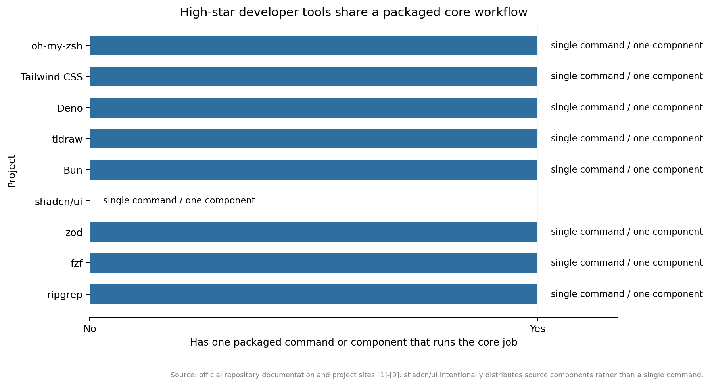

# Developer Tool Adoption Playbook: Conditions for Reaching 100,000 GitHub Stars

## Executive summary

A repository reaches 100,000 stars when it combines a frequent, measurable pain with a near-instant demonstration and an external mechanism that repeatedly exposes the project to new developers. It is not the result of a good README alone. The recurring structural property across the examined tools is a packaged core workflow: one command, one script, one drop-in component, or one integration that immediately produces a visible result. Stars accumulate only after that workflow is embedded in package managers, shells, frameworks, editor surfaces, existing configs, or an emerging standard. Visual launch material helps communication, but it is not a substitute for a runnable benefit.

The evidence also shows that 100,000 stars is not a uniform adoption threshold. The current sample includes projects that are workflow defaults, component libraries, runtime platforms, and configuration frameworks. Several named candidates, including ripgrep, fzf, htmx, zod, shadcn/ui, bun, tldraw, and the MCP servers repository, remain below 100,000 stars in the examined records. Their inclusion here is justified because they expose the same adoption mechanics; it would be inaccurate to treat them as 100,000-star examples. Only oh-my-zsh, Deno, and Tailwind CSS are verified at or above that level in the available records.

A credible day-one release should make a skeptic complete one successful run in 30 seconds, show the result in the same viewport, fail with a recoverable error, explain compatibility and security boundaries, and give the user a clear next task. The strongest channels are distribution through adjacent developer workflows, ecosystem packaging, peer recommendation, ranked search and assistant responses, and technically substantive community discussion. Hacker News, Product Hunt, X, launch videos, and trending pages can cause short-term visibility, but none is reliably causal for durable star growth. The appropriate release gate is a 14-criterion checklist, not a star target.

## The 100,000-star threshold is a compound event, not a launch outcome

Star counts are delayed, heterogeneous, and often conflated with attention. A 100,000-star project usually crosses that threshold after years of compounding exposure, a large installed base, or both. Oh-my-zsh is listed with 190,200 stars, Deno with 92,800 in one examined record and 108,785 in another, and Tailwind CSS with 98,000. The disparity between Deno snapshots shows why a single reported figure should be treated as a point-in-time observation rather than a permanent fact. MCP servers appears at 91,800 stars, while the other candidates sit below 100,000: ripgrep at 69,900, fzf at 84,100, htmx at 47,100, zod at 44,182, shadcn/ui at 127,200, bun unverified in the available records, and tldraw at 50,700. Shadcn/ui is the exception above the threshold, but its unusually high count is not independently reconciled here and should be treated as a reported value rather than a validated adoption measure.

These differences also show that a high star total can mean different things. Oh-my-zsh spreads through shell configuration and theming; Deno and Bun are runtime platforms with built-in toolchains; Tailwind CSS is a workflow and styling convention; shadcn/ui distributes owned component source rather than a conventional dependency. Zod, ESLint, and Prettier spread through editor and CI integration. MCP servers aggregate a new protocol ecosystem. Bun, Deno, and tldraw benefit from strong institutional backing. Star count therefore cannot identify a single playbook. The common condition is visibility combined with repeated use, not visibility alone.

The correct research question is not “how do I get 100,000 stars?” It is “how does a project move from being seen once to becoming part of someone’s daily workflow?” Stars can be the residue of that transition, but they do not establish installation, activation, weekly use, production deployment, or contributor supply. A launch can produce a star spike without changing any of those later variables.

*Figure 1: Among the examined tools, all but shadcn/ui expose one packaged command or component that immediately performs the core job. Data source: official repository documentation and project sites [1]-[9].*

## Ten examined projects expose the same activation mechanics

The table uses “under 30 seconds” only when installation and first run can plausibly complete in that time on a prepared machine. It does not assume a developer has already installed a runtime, package manager, or build tool. Time-to-first-value is classified as fast when a one-line install plus one command or import produces output, demo when the website itself demonstrates the value, and platform when the benefit requires a project scaffold or application context.

| Project | Pain removed | First-value path | Distribution mechanism | What made it spread |
|---|---|---|---|---|
| ripgrep | Recursive search that respects `.gitignore` and filters binaries by default | Fast: install and run `rg pattern` | Package managers and prebuilt binaries; embedded in VS Code and editors | Speed is visible in real work; project description and FAQ state that `.gitignore`, hidden files, and binaries are skipped by default [1] |
| fzf | Choosing an item from an arbitrary list is slower than typing a fuzzy query | Fast: pipe a list and select | Homebrew, Linux package managers, git install, shell plugins, Vim/Neovim plugins | Replaces history search, file picking, and completion; the README documents broad OS packaging and shell/editor integration [2] |
| htmx | Server-rendered applications need dynamic behavior without a full SPA framework | Demo: HTML attributes shown in the README | Official site and documentation, developer writing, natural fit with hypermedia workflow | Small dependency-free runtime and a clear contrarian positioning; README describes AJAX, transitions, WebSockets, and server-sent events accessed through HTML attributes [3] |
| zod | Schema validation and TypeScript type inference duplicate the same contract | Fast: define, parse, infer a type | npm, IDE adoption, framework ecosystem | One declaration covers runtime parsing and static types; README states zero dependencies and browser/Node support [4] |
| shadcn/ui | Teams want component ownership rather than an opaque dependency | Fast in an existing supported app | CLI registry, documentation site, component ecosystem | Components are copied into the application; repository description says they are customizable and extendable [5] |
| bun | JavaScript toolchain fragmentation across runtime, package manager, bundler, and test runner | Fast: `bun run`, `bun test`, `bun install` | Standalone executable, install scripts, npm, Homebrew, Docker | One binary with several common tools; README lists Linux, macOS, and Windows binaries plus package managers [6] |
| tldraw | Building a collaborative canvas requires low-level graphics, editing, and persistence work | Demo on hosted app and editor examples | npm packages, starter kits, production case studies | Visual output is immediate and visibly useful; documentation highlights shapes, undo/redo, themes, and cross-tab sync [7] |
| oh-my-zsh | Zsh configuration is tedious to assemble and share | Fast after shell install: curl/wget script | Word-of-mouth, theming culture, plugin ecosystem, auto-update | Thousands of extension points make the framework a social distribution network; site documents 300+ plugins and 150 themes [8] |
| Deno | Node projects require multiple separate tools and an insecure-by-default runtime model | Fast: install and run a TypeScript file | Install script, Homebrew, PowerShell, package ecosystem | Secure defaults, built-in tooling, and a recognizable creator narrative; README provides installation and a first server example [9] |
| Tailwind CSS | Writing and reconciling custom CSS classes repeats decisions across components | Fast in a scaffolded project | Utility classes, design-system conventions, framework and deployment ecosystem | Markup becomes the demo; repository is listed as a utility-first CSS framework [10] |

The comparison reveals three distinct adoption shapes. The first is the replacement tool: ripgrep, fzf, zod, ESLint, and Prettier solve a job developers already perform. Their first-value claim is comparative and measurable. The second is the workflow alternative: Bun, Deno, and Tailwind CSS replace several steps or a familiar convention. Their claim is larger, so activation depends on compatibility and migration cost. The third is the extensible substrate: oh-my-zsh and MCP servers offer a core plus a registry of plugins or servers. Their growth depends less on one feature and more on how many other developers can attach useful content.

The correct day-one strategy is therefore determined by the product shape. A replacement tool should lead with a benchmark, a compatibility table, or a before/after. A workflow alternative should lead with a migration path and an escape hatch. An extensible substrate should lead with a minimal working extension and a clear contribution contract. A generic “build in public” launch does not serve any of these shapes equally.

## The common structure is a low-friction boundary, not a fixed feature checklist

Zero configuration should mean that the core use case works without editing files or reading conceptual documentation. It does not mean the project lacks configuration. Ripgrep’s defaults skip binaries and ignored files. fzf starts as a filter and gains key bindings, completion, and a preview later. Zod parses a schema without plugins. Bun runs TypeScript and JSX without an external bundler in the basic case. Tailwind requires a project setup, but the core utility model then needs no new component API. These projects earn their minimal-config reputation because the default behavior matches the common case.

A 30-second demonstration requires three adjacent surfaces: a one-line command, an observable output, and a visible result. For a CLI, that can be one terminal block with input and output. For a UI component, it can be a live preview followed by copyable source. For a protocol or SDK, it can be a minimal client configuration. The repository is not the only delivery surface. The shadcn/ui repository README is deliberately sparse and directs users to the documentation site. Tldraw provides an online editor and example applications. MCP servers documents a collection of runnable servers. A 30-second demo can live on a project site, a package page, a registry, or an editor template; it does not have to live exclusively in the README.

Cross-platform distribution reduces the first failure point. fzf documents installation on macOS, Linux, BSD, and Windows. Bun lists Linux, macOS, and Windows binaries and offers installation through several package managers. Deno offers shell, PowerShell, Homebrew, and Chocolatey paths. Even when a project is inherently local or single-platform, the README must state that boundary explicitly. A tool that only works on Linux should say so above the fold. Concealing the constraint creates a worse first impression than owning it.

Naming should make the replacement relationship or primary object obvious. `ripgrep`, `fzf`, `bun`, and `tldraw` are short and memorable, but none explains the entire product. Clear naming works when it is reinforced by a one-sentence positioning statement. “Opinionated code formatter,” “utility-first CSS framework,” “modern JavaScript and TypeScript runtime,” and “interactive fuzzy finder” communicate more than clever wordplay. The repository description should contain the job, the target user, and the primary interface in one line.

The minimum README sequence is a one-sentence outcome, an installation command, a first run with input and output, a real task, compatibility and requirements, extensibility, and contribution guidance. A screenshot or short animation belongs immediately after the first run because it proves the benefit without requiring installation. fzf and tldraw benefit particularly from this treatment because their value is interactive. A project that only exposes a REST API or an SDK still needs a terminal-to-output example; an architecture diagram is not a demo.

The license must match the intended distribution path. Permissive licenses lower legal friction for proprietary software, while copyleft licenses impose different obligations on derivative works. For a developer tool, the operational requirement is a visible, unambiguous `LICENSE` file and a clear statement when the repository contains multiple components under different terms. Anthropic’s Claude Agent SDK repository illustrates the risk: it states that use is governed by Anthropic’s commercial terms except where another component license applies. Such mixed licensing must be disclosed on the landing page, not only in a source subdirectory.

## Extensibility turns early users into repeat distributors

The strongest long-term spreaders let other developers solve adjacent problems without modifying the core. Oh-my-zsh provides plugins and themes. fzf supports custom key bindings, completion, and integrations. ESLint and Prettier allow custom rules and plugins. MCP offers servers, SDKs, and client integrations. Bun and Deno package adjacent tools inside one runtime. These mechanisms matter because they convert downstream tools into free distribution nodes: each new plugin, integration, or tutorial exposes the host project to another audience.

Extensibility must have a small, runnable contract. A contributor should be able to copy a plugin template, implement one interface, and see the extension loaded. If the extension API requires reading thousands of lines of core code, the project has an extension mechanism but no extension onboarding. Documentation should distinguish internal extension points from stable public APIs and state the compatibility policy. Without that distinction, early integrators become long-term maintenance liabilities.

Contributor onboarding should include a `CONTRIBUTING` guide, issue templates, tested build instructions, and a limited number of well-scoped starter tasks. GitHub’s documentation recommends checking whether a repository is actively maintained before contributing and points users toward recent activity, issue labels, and contribution guidance. Its contributor discovery guidance also highlights `good first issue` and `help wanted` labels. These labels are onboarding aids, not guarantees of mentorship.

The hardest onboarding rule is to make a contributor’s first patch mergeable in one sitting. A newcomer should not need private credentials, a proprietary service, a full microservice environment, or undocumented tribal knowledge. The repository should provide a mock or local fixture for integrations that cannot run offline. A contributor who cannot produce a test result locally will not improve the project and may publicly warn others against trying.

## Screenshots and animations are proof surfaces, not decoration

A visual launch works when it makes the outcome legible faster than prose. fzf’s interactive selection, tldraw’s canvas, shadcn/ui’s component gallery, and Tailwind’s styled markup can all be understood from a single image. A good visual should show the input, the control, and the resulting change. A polished hero illustration without those elements is brand design, not activation material.

The image must match the first run. If the README shows an animation recorded against a proprietary database or a modified development build, it creates doubt about the public release. Every visual should correspond to a command, code block, or project URL. Accessibility matters for the same reason: captions, descriptive alt text, keyboard instructions, and a text-based fallback make the proof usable by more people.

For command-line tools, a static output block can be more convincing than a silent animation because it is inspectable. For UI tools, video should show latency, responsiveness, and an actual edit rather than a narrated feature tour. The distribution rule is simple: optimize the first evidence for the medium where the user already is. A README needs a short clip; a conference talk needs a narrative; an integration page needs a setup snippet; a registry needs a live endpoint. Reusing the same hero video everywhere is a sign that the launch is being treated as content rather than product activation.

## New tools fail when attention arrives before the product can retain it

The most common failure mode is an impressive demo with no dependable execution path. A repository may show a sophisticated result while omitting runtime requirements, network conditions, model credentials, or the environment used to record the demonstration. When the first user cannot reproduce the output, the launch has advertised a capability the project cannot yet deliver at scale.

The second failure mode is pain without ownership. A tool may be technically interesting but not something a developer is authorized to add to a project. This includes internal data, proprietary services, unpaid models, unapproved licenses, or workflows that require production credentials. Stars can express agreement with the idea while adoption is blocked by organizational constraints.

The third is a one-command demo followed by unbounded configuration. A `curl | bash` installation creates an artificial time-to-value, but if the useful result still requires YAML files, API keys, container setup, and a proprietary account, the project has not reduced friction. The benchmark must be measured after the user already has the runtime, not after the maintainer has prepared the environment.

The fourth is opaque security behavior. Agent tools, shell plugins, code executors, and filesystem utilities must disclose privileges, sandbox boundaries, outbound network access, and destructive commands. A generic “run it in a sandbox” instruction does not define which risks are removed. Codex CLI’s documentation of a default sandbox, directory allow lists, and CI mode is more credible than a vague safety statement because it tells the operator what the tool can and cannot do.

The fifth is branding without searchable evidence. A repository name, tagline, or demo video cannot substitute for error messages, migration guides, framework documentation, public issues, and examples that match real stack queries. A developer searching for a specific error or integration should find an answer without knowing the project exists.

The sixth is a release accompanied by announcement infrastructure but no maintenance capacity. A Discord server, newsletter, X account, and conference talk create expectations of responsiveness. If the first issues and pull requests are ignored, the project signals that early adopters are guinea pigs rather than users. The appropriate launch discipline is to cap channels to the number of conversations the team can answer.

The seventh is false precision. A benchmark without input size, hardware, warm-up, version, operating system, command line, and confidence interval is marketing material. The same applies to token savings, latency reductions, and “production ready” claims. A small, reproducible benchmark is more credible than a broad claim with no experimental record.

The eighth is dependency on a single person, vendor, or model. Anthropic’s Claude Agent SDK and OpenAI’s Codex CLI are credible partly because of institutional backing, but that also creates vendor concentration. A day-one tool should state which components are open source, which are proprietary, which APIs may change, and whether a customer can replace the provider.

Failed projects rarely publish adoption metrics, so direct comparisons are scarce. Observable warning signs include a star spike with few clones or installs, issues that remain unanswered, no repeat contributors, deleted examples, broken migration paths, and repository activity that stops soon after launch. A repository may still be a useful learning resource under those conditions, but it should not be described as an adopted product.

## A strict 14-point launch scorecard should reject most early releases

The following criteria are checkable and intentionally conservative. Every item should be demonstrated with a public artifact: a URL, a screenshot, a recorded run, a package version, or a tested command. A release that fails more than two items should remain pre-release. A launch manager should not approve a public announcement merely because the build passes.

| # | Criterion | Evidence required |
|---|---|---|
| 1 | One sentence states the user, the job, and the replacement | README top section and repository description |
| 2 | A new machine can complete the core task in 30 seconds | Recorded run using only documented steps |
| 3 | The first example shows both command and output | README block or a visible demo |
| 4 | Requirements and unsupported environments are explicit | Requirements section or compatibility table |
| 5 | The claimed result is reproduced from a clean environment | CI run, container, or second-machine recording |
| 6 | The first error has a documented recovery path | Troubleshooting page or example issue |
| 7 | A license file is present and legible | Repository `LICENSE` |
| 8 | All non-open or differently licensed components are disclosed | License matrix or architecture document |
| 9 | A stable extension point has a runnable example | Plugin, hook, SDK, or integration template |
| 10 | Contributor build instructions pass in CI | Passing workflow and setup documentation |
| 11 | At least three well-scoped first issues exist | Labeled issues with acceptance criteria |
| 12 | A screenshot, animation, or interactive demo matches the first run | Public image, video, or live URL |
| 13 | Security boundaries are explicit | Permissions, sandbox, and threat-model section |
| 14 | The team can triage the first 20 issues and pull requests | Staffing plan and defined owners |

The checklist rejects three common release shapes. It rejects the “launch now, document later” repository because reproducible execution is mandatory. It rejects the “viral demo” because the demo must correspond to a clean installation. It rejects the “community first” release because contributor onboarding, triage capacity, and legal disclosure must exist before growth arrives.

A score of 14 does not guarantee adoption. It only establishes that the project can survive its first users. Real adoption should then be measured through daily or weekly active use, successful first runs, repeat runs, conversion to contributors, downstream integrations, resolved issues, and retention after the launch spike.

## Distribution in 2026 works through workflow proximity and search persistence

The channels that produce durable star growth share one feature: they place the project where a developer is already solving the related problem.

1. **Ecosystem integration and packaging.** Being installed through Homebrew, npm, pip, a framework template, an editor extension, or an operating system package manager exposes the project during ordinary work. fzf, ripgrep, Bun, Deno, and Tailwind all benefit from this path.
2. **Adjacent workflow insertion.** MCP servers, fzf shell bindings, ESLint editor plugins, and shadcn/ui component registry work because they attach to an environment the user already operates.
3. **Searchable, problem-shaped content.** Documentation should answer “how do I accomplish X?” rather than only describing what the project is. Framework guides, error messages, migration notes, and integration examples make the project findable after the launch has ended.
4. **Communities of practice.** Hacker News, specialized forums, language communities, and peer recommendations convert attention into trials when the discussion is technically substantive. The project must be able to answer questions in the thread without pivoting to promotional language.
5. **Ranking systems and recommendation surfaces.** GitHub Explore and Trending, package-search pages, Awesome lists, AI assistants, and search engines create long-tail discovery. These surfaces respond to structured metadata, linked repositories, stable URLs, and externally hosted documentation. Their value lies in persistence, not launch-day amplification.
6. **Live demonstrations.** Project sites, online sandboxes, and interactive examples convert visitors who will not install software immediately.

The myth list is equally important.

- **“Trending guarantees adoption.”** Trending is a temporary visibility surface. Without a packaged workflow, it produces attention that does not persist.
- **“Posting on Hacker News or Product Hunt is a growth channel.”** It can create a spike, but a causal conversion rate is rarely available. The discussion quality and an immediately usable artifact matter more than the post title.
- **“X, LinkedIn, or a launch video builds durable growth.”** Social media and video are announcement channels. Their value is real but short-lived unless they link to an executable artifact and recurring content.
- **“More features create more stars.”** Additional options increase the number of concepts a user must understand. A first release should solve one task with one or two paths, then extend.
- **“AI agents will recommend the tool automatically.”** Assistant recommendations depend on indexed documentation, stable URLs, clear comparisons, and recognizable problem wording. A social-media announcement is insufficient.
- **“An Awesome-list entry is a launch channel.”** A curated list is a discovery node for an established category, not a substitute for product readiness.
- **“Stars prove product-market fit.”** A star does not establish installation, activation, retention, or production use.

A new project should use three or four channels at most. A practical allocation is one adjacent ecosystem channel, one search/content channel, one community where the target users already gather, and a recorded live demo. All four should link to the same minimal installation path. Splitting the announcement across ten platforms reduces the team’s ability to answer questions where adoption actually begins.

## A credible day-one release is a testable conversion system

The first release should optimize for one measurable sequence: visitor understands the pain, copies one command, obtains a visible result, performs a second task, and knows where to ask for help. Everything else should be removed or deferred. The README should be a landing page for people who can run code, while the documentation site should carry design decisions, APIs, and migration material.

The launch should ship with two versions of every major claim: a short marketing sentence for scanning and a reproducible specification for evaluation. The specification should include version, environment, input, command, output, and failure conditions. This discipline prevents a technically impressive but nonreproducible announcement.

A credible roadmap should prioritize stability, compatibility, and responsiveness over feature count. If the project is extensible, the team should publish the smallest possible plugin and maintain it. If it is a CLI, it should preserve stable flags and obvious error messages. If it is an agent tool, it should make privileges legible. If it is a library, it should expose a small public surface and avoid making every internal module an integration point.

Day-one infrastructure should include issue triage, release notes, security disclosure, CI, reproducible examples, and at least one person responsible for documentation. None of this directly produces stars, but all of it determines whether the launch converts attention into retention.

## The realistic goal is a compounding conversion loop, not a star number

The 100,000-star projects in this review became reference points because their workflow was repeatedly encountered by new developers, easy to demonstrate, and useful enough to share. Their distribution mechanisms were not interchangeable: oh-my-zsh grew through configuration culture; Tailwind through utility conventions and ecosystem content; Deno and Bun through bundled toolchains and institutional reach; ripgrep and fzf through repeated local use; MCP servers through an emerging protocol and a broad integration surface.

A new tool should pick the mechanism that fits its product shape and build the release around it. A replacement tool needs a credible comparison and visible performance. A workflow tool needs a migration path and compatibility guarantees. An extensible platform needs a minimal, runnable extension and governance clarity. A UI or agent tool needs a visual demonstration paired with explicit permission boundaries.

The practical target is therefore not 100,000 stars in an arbitrary period. It is a measurable activation loop in which each new distribution node sends qualified developers to a reliable first run, a fraction retain, some share the project, and some contribute extensions that expose it to the next node. Star count is one trailing indicator of that loop. A release should not be approved before the loop can run at all.

## Limitations and evidence notes

This report relies on official repository front pages, project documentation, GitHub documentation, and contemporary search results. It does not include private telemetry from GitHub, package registries, or individual projects. Star counts are especially unstable: public trackers, API snapshots, and search indexes vary by date and may revise historical totals. Deno and shadcn/ui illustrate this problem directly. Numbers are therefore reported as observed records rather than guaranteed current values.

The report does not claim that every project follows the same timeline or that the listed mechanisms are individually causal. The 100,000-star threshold was reached over years for many of these projects, and external sponsorship, founder reputation, and platform ownership contributed in ways that cannot be separated from the public artifacts. Several tools in the comparison set are below 100,000 stars in the examined records, so their role is illustrative rather than statistical validation.

“Time to first value” is estimated from documented install and usage steps, not measured across a controlled sample of developers. Channel effectiveness is supported by structural evidence and documentation rather than randomized experiments. Claims about Hacker News, Product Hunt, X, video, and AI recommendations should therefore be read as skeptical priors, not measured conversion rates.

## References

[1] https://ripgrep.dev/docs/faq/
> “ripgrep is a line-oriented search tool that recursively searches directories for a regex pattern.”

[2] https://github.com/junegunn/fzf
> “fzf is a general-purpose command-line fuzzy finder.”

[3] https://github.com/bigskysoftware/htmx
> “htmx allows you to access AJAX, CSS Transitions, WebSockets and Server Sent Events directly in HTML.”

[4] https://github.com/colinhacks/zod
> “Zod is a TypeScript-first schema declaration and validation library.”

[5] https://github.com/shadcn-ui/ui
> “A set of beautifully designed components that you can customize, extend, and build on.”

[6] https://github.com/oven-sh/bun
> “Bun is an all-in-one toolkit for JavaScript and TypeScript apps.”

[7] https://tldraw.dev/
> “Skip the canvas setup and focus on what makes your product unique.”

[8] https://ohmyz.sh/#install
> “Oh My Zsh is an open source, community-driven framework for managing your Zsh configuration.”

[9] https://github.com/denoland/deno
> “Deno is a JavaScript, TypeScript, and WebAssembly runtime with secure defaults.”

[10] https://github.com/tailwindlabs/tailwindcss
> “A utility-first CSS framework for rapid UI development.”

[11] https://opensource.org/?p=452851
> “Open Source software can be used, studied, modified, and shared by anyone without needing further approval.”

[12] https://docs.github.com/en/get-started/exploring-projects-on-github
> “Stars help you keep track of repositories and topics you want to revisit.”

[13] https://github.com/BurntSushi/ripgrep
> “By default, ripgrep will respect gitignore rules and automatically skip hidden files/directories and binary files.”

[14] https://github.com/junegunn/fzf
> “You can download fzf executable alone if you don't need the extra stuff.”

[15] https://github.com/tldraw/tldraw
> “You can use tldraw to create a drop-in whiteboard for your product or as the foundation on which to build your own infinite canvas applications.”
